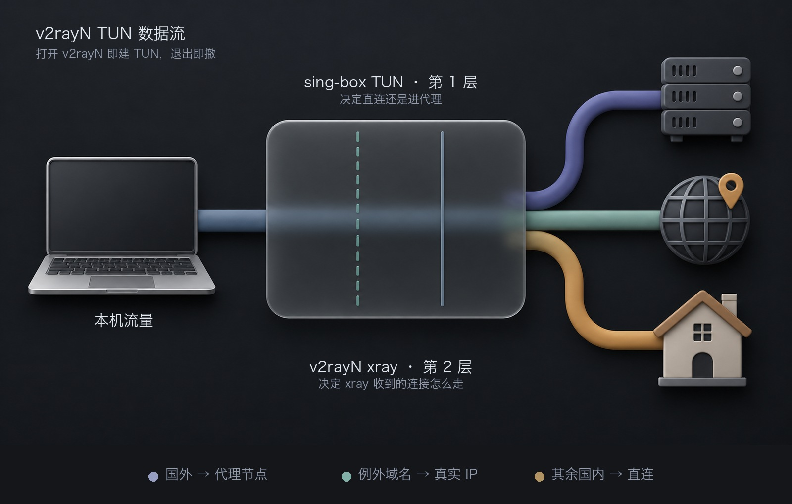

# v2rayN TUN


把 v2rayN 的代理变成系统级 TUN：打开 v2rayN 就有 TUN，退出即撤掉。

v2rayN 7.25.4 自带的 TUN 在 macOS 上有两个源码级问题，这个仓库用独立的 root 守护
接手，绕开它们，并且补上路由、DNS、网络切换这些 v2rayN 管不到的部分。



## 三条出路

TUN 起来后，流量按目标分三路：

| 目标 | 出站 | 出口 | 用途 |
|---|---|---|---|
| 国外 | `proxy` → `127.0.0.1:10808` → xray → 节点 | 节点 IP | 日常代理 |
| 例外域名 / IP | `direct` | 真实 IP | 只认国内 IP 的站（微信、教育、政务）|
| 其余国内 | `cn-via-jp` | 直连或指定节点 | 默认直连 |

例外清单在 `~/.v2rayn-tun/extra-direct.txt` 和 `extra-direct-ip.txt`，改完重启守护生效。

## 两层路由

流量要穿过两层，两层都得配：

```
应用 → TUN(sing-box) → proxy → xray(v2rayN) → 节点
        第 1 层                  第 2 层
```

- **第 1 层** 决定哪些走直连、哪些进代理。改这里是 `per-app-routing.py`。
- **第 2 层** 决定 xray 怎么处理收到的连接。在 v2rayN 里选 `V4-禁直连(TUN 专用)`，
  这个配置项由 `scripts/make-routing-profile.py` 生成。

只改一层会出现「国内能开、国外不能」或者反过来。


## 安装

```bash
sudo ./install.sh
```

前置：**手动启动过一次 v2rayN**，让它把 `sing-box` 和 `.srs` 规则集释放到
`~/Library/Application Support/v2rayN/bin/`。

装完还要配路由。这一步依赖你自己的订阅，所以单独执行：

```bash
sudo ./scripts/setup-routing.sh --cn-node 日本CN2-3
```

再打开 **v2rayN → 设置 → 路由设置 → 选中「V4-禁直连(TUN 专用)」**。

验证：`./scripts/setup-routing.sh --check`

卸载：`sudo ./uninstall.sh`

## 排除清单

TUN 的覆盖路由里有一条 `8.0.0.0/5`，范围覆盖 `8.0.0.0` 到 `15.255.255.255`，
`10.0.0.0/8` 整个落在里面。不排除的话，校园网、路由器后台、WireGuard 对端都会被抓进 TUN。

排除清单写在 `~/.v2rayn-tun/tun-exclude.txt`，守护每次启动都会合并进配置：

```
10.0.0.0/8          校园网
192.168.99.0/24     WireGuard 隧道段
```


## 三个免 sudo 开关

装完之后日常调整不需要密码，最多 5 秒生效：

```bash
# 临时关闭 TUN，回到纯 v2rayN 本地代理
touch ~/Library/Application\ Support/v2rayN/tun-disabled
rm    ~/Library/Application\ Support/v2rayN/tun-disabled

# 临时调 MTU（576-9000）。生成后会用 sing-box check 校验，失败自动回退
echo 1500 > ~/Library/Application\ Support/v2rayN/tun-mtu
rm   ~/Library/Application\ Support/v2rayN/tun-mtu

# 不经过 TUN 的网段
vim ~/.v2rayn-tun/tun-exclude.txt
```

三个文件都只影响本机 TUN，守护只读不执行。

## 守护进程

| 组件 | 级别 | 作用 |
|---|---|---|
| `com.local.v2rayn-tun` | system | 建 TUN、跟随 v2rayN 启停、代理断开时切 kill-switch |
| `com.local.v2rayn-dnsguard` | system | 修 DNS 污染、网络切换后重绑定 |
| `com.local.v2rayn-sleepguard` | system | 合盖时阻止休眠，超时自动恢复 |
| `com.local.v2rayn-quitguard` | gui | Cmd+Q 拦截，只对 v2rayN 生效 |
| `com.local.codex-tls-relay` | system | 可选，给证书过期的上游做本地 TLS 中转 |

`install.sh` 装前四个，最后一个是可选的，见 [docs/toolbox](docs/toolbox.md)。

## 目录

```
v2rayN-tun/
├── install.sh / uninstall.sh     # 安装 / 卸载
├── config/sing-box.json          # TUN 的基础配置
├── daemon/                       # run-tun.sh / dnsguard.sh / sleep-guard.sh / quit-guard.swift
├── launchd/                      # 各 LaunchDaemon / LaunchAgent
├── scripts/                      # 路由生成、节点切换、体检工具
└── docs/                         # 排查记录
```

脚本和配置里的 `__USER_HOME__` 由 `install.sh` 换成真实路径，仓库可以直接复用到别的机器。

## 排查

```bash
# 守护日志
sudo tail -f /var/log/v2rayn-tun.log

# 守护状态
sudo launchctl print system/com.local.v2rayn-tun | head -20

# 改完配置重启
sudo launchctl kickstart -k system/com.local.v2rayn-tun

# 体检：路由、例外、节点、环路
./scripts/diagnose.sh

# 环路检查：节点 IP 是否被 TUN 吃掉
./scripts/fix-loop.sh --check
```

排障时注意，**TUN 模式下 `ping`、`nc`、`curl -w '%{time_connect}'` 的数字都不可信**，
sing-box 会直接应答。要测真实连通性，用独立客户端走物理网卡。

## 文档

`docs/` 下是 22 篇排查记录，每篇顶部有一句话总结。建议从这几篇开始：

| 主题 | 说明 |
|---|---|
| [00 整体架构](docs/00-architecture.md) | 数据流、组件、开关、脚本一览 |
| [18 风险登记](docs/18-risk-register.md) | 当前已知风险与已排除项 |
| [19 路由实施](docs/19-routing-implementation.md) | 国内出口、两层配置、切网测试 |
| [21 TUN 吃内网](docs/21-tun-eats-private-networks.md) | 覆盖路由与排除清单 |
| [22 住宅 IP 鉴别](docs/22-identifying-residential-ip.md) | whois/BGP/PTR 判出口画像 |

完整索引见 [docs/README.md](docs/README.md)。
